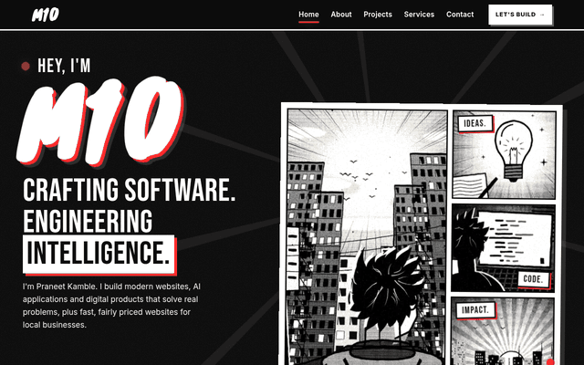
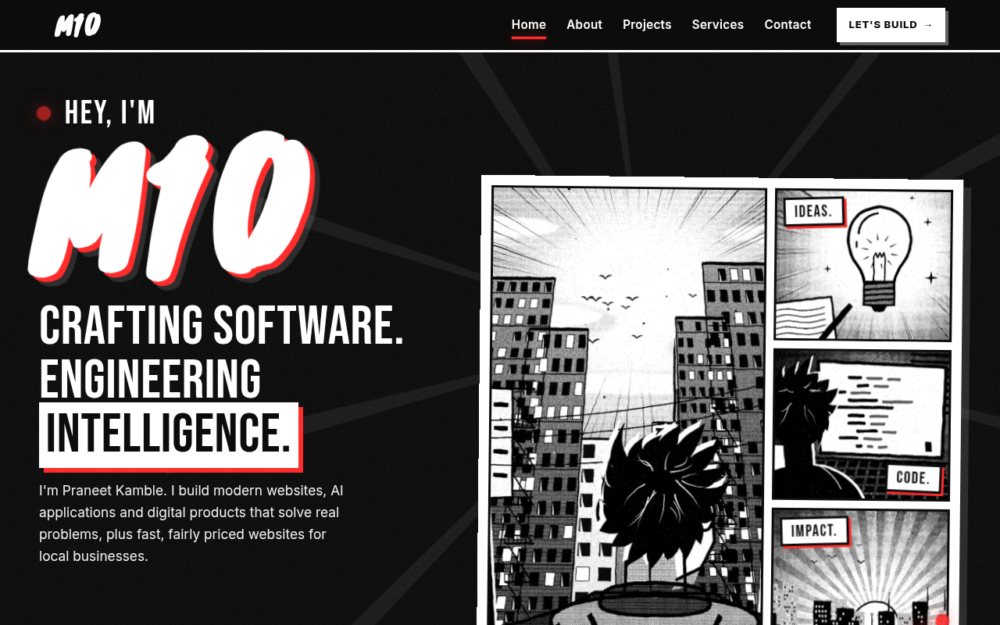
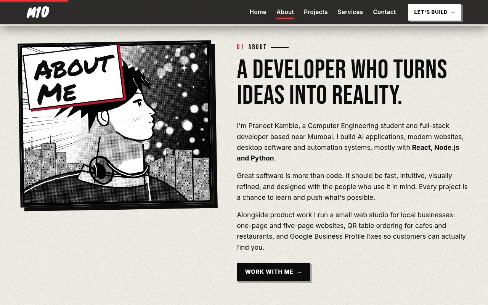
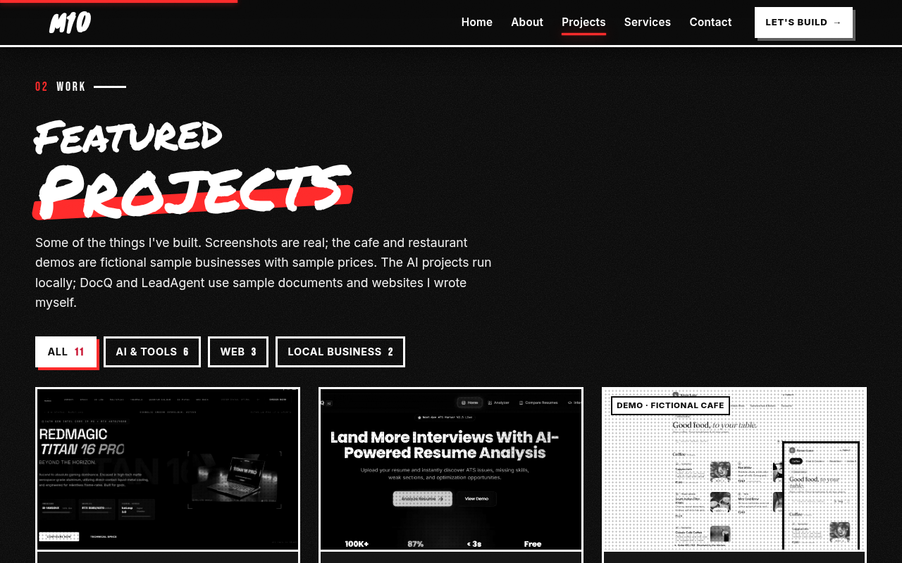
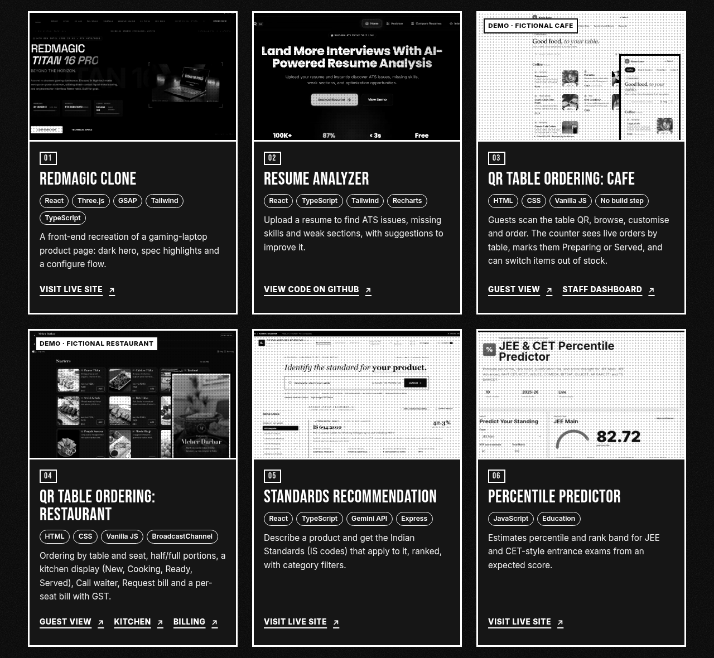
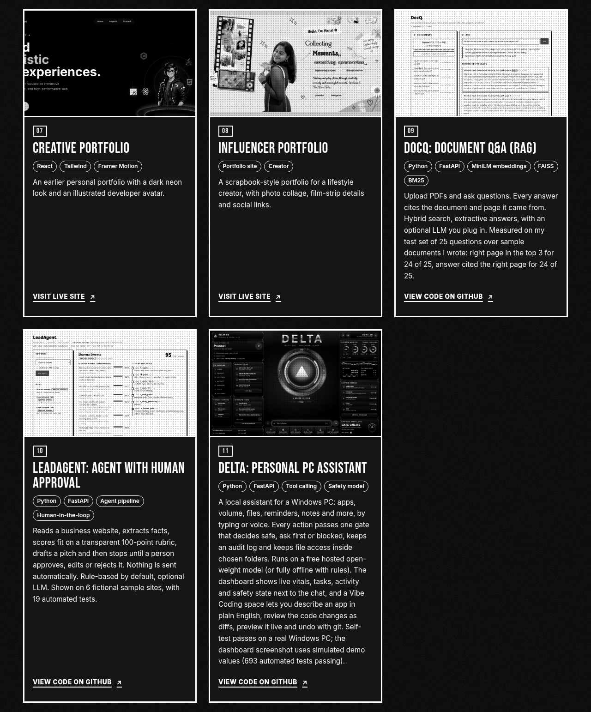
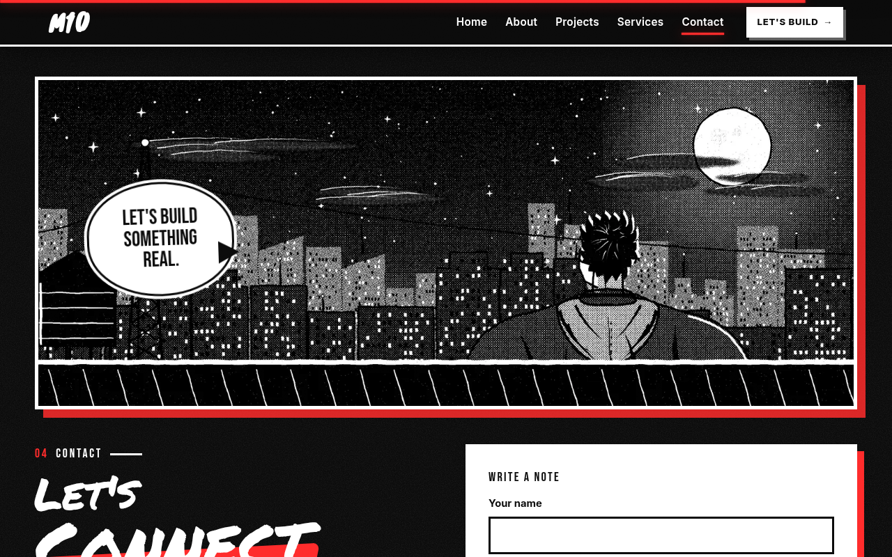
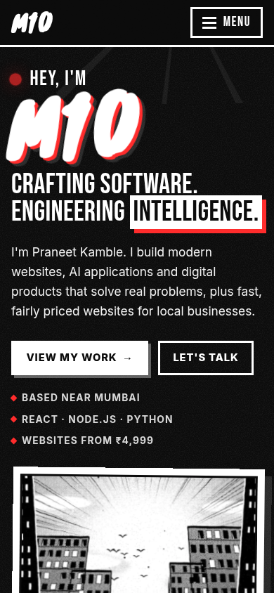

# M10 Portfolio

### Praneet Kamble: websites, AI applications and digital products


A single-page portfolio with a manga-style design: bold black panels, ink illustrations and one red accent. It presents 11 projects, the services I offer, and ways to get in touch. It is plain HTML, CSS and JavaScript, with no framework and no client-side build tooling.

**Live site: [https://m-10-nu.vercel.app](https://m-10-nu.vercel.app)**



---

## ✨ What the site contains

| Section | Content |
|---|---|
| **Home** | Hero with illustrated manga panels, a short introduction and calls to action |
| **About** | Short introduction (Computer Engineering student and full-stack developer based near Mumbai) and a quick-facts strip: 11 projects and demos, 2 working QR-ordering demos, 3 core tools (React, Node.js, Python) |
| **Projects** | 11 project cards with filters: All (11), AI & Tools (6), Web (3), Local Business (2) |
| **Services** | Website development, AI solutions, UI/UX design, Local Boost (Google Business Profile fix) and QR table ordering |
| **Quick answers** | A short FAQ |
| **Contact** | Email, WhatsApp, LinkedIn and GitHub links, plus a short form that opens the visitor's email app |

### The 11 projects

| # | Project | Stack / type |
|---|---|---|
| 01 | RedMagic Clone | React, Three.js, GSAP, Tailwind, TypeScript |
| 02 | Resume Analyzer | React, TypeScript, Tailwind, Recharts |
| 03 | QR Table Ordering: Cafe (working demo, fictional cafe) | HTML, CSS, vanilla JS, no build step |
| 04 | QR Table Ordering: Restaurant (working demo, fictional restaurant) | HTML, CSS, vanilla JS, BroadcastChannel |
| 05 | Standards Recommendation | React, TypeScript, Gemini API, Express |
| 06 | Percentile Predictor | JavaScript, education |
| 07 | Creative Portfolio | React, Tailwind, Framer Motion |
| 08 | Influencer Portfolio | Portfolio site, creator |
| 09 | [DocQ](https://github.com/praneetkamble/docq): Document Q&A (RAG) | Python, FastAPI, MiniLM embeddings, FAISS, BM25 |
| 10 | [LeadAgent](https://github.com/praneetkamble/leadagent): agent with human approval | Python, FastAPI, agent pipeline, human-in-the-loop |
| 11 | [Delta](https://github.com/praneetkamble/delta): personal PC assistant | Python, FastAPI, tool calling, safety model |

The cafe and restaurant demos are fictional sample businesses with sample prices. DocQ and LeadAgent run on sample documents and websites written for the demos.

---

## 📷 Screenshots

### Home


### About


### Projects






### Contact


### Mobile


---

## 🎨 Design approach

- **Manga-style panel layout.** Bold black panels, ink illustrations with screentone shading and rough brush edges, and torn-paper section transitions. The illustrations are original artwork rendered for this site.
- **One accent colour.** Red is used for underlines, shadows, counters and hover states, so the black-and-white art stays dominant.
- **Accessible by default.** Skip-to-content link, labelled landmarks and navigation, and all motion switched off under `prefers-reduced-motion`. Touch devices do not get hover-only effects such as tilt or cursor ring.
- **Responsive.** The layout adapts from wide desktop screens to phones.
- **No framework.** Plain HTML, CSS and JavaScript keep the page small and easy to host anywhere.

---

## 🧩 Tech stack

- **Markup, styling and behaviour:** HTML5, CSS3 and vanilla JavaScript (`index.html`, `style.css`, `script.js`).
- **Images:** WebP for illustrations and project screenshots.
- **Fonts:** Google Fonts (Bebas Neue, Inter, Knewave, Permanent Marker). This is the only external dependency of the main page.
- **Demos:** the cafe and restaurant QR-ordering demos are self-contained static pages that sync between tabs with BroadcastChannel and localStorage.

---

## 📂 Project structure

```text
M-10/
├── index.html            # the single page: home, about, projects, services, FAQ, contact
├── style.css             # all styles
├── script.js             # navigation, filters, reveals, counters, contact form
├── assets/
│   ├── art/              # ink illustrations (WebP)
│   └── img/              # project screenshots (WebP)
├── demos/
│   ├── cafe/             # QR table-ordering demo
│   └── restaurant/       # QR table-ordering demo
├── build.mjs             # copies the static files into dist/
├── package.json          # defines "npm run build"
├── dist/                 # build output served by Vercel (generated, not committed)
└── docs/                 # README screenshots and preview GIF
```

---

## 🚀 Run it locally

The site is static. To preview it locally, serve the folder over http (the QR-ordering demos do not work from `file://`):

```bash
python3 -m http.server 8080
# open http://localhost:8080
```

To produce the same `dist/` folder that Vercel serves, run `npm run build` (Node.js is required, no dependencies are installed).

---

## ☁️ Deployment

The repository is connected to Vercel, so a push to `main` triggers a new deployment.

1. Vercel runs `npm run build`, which executes `build.mjs`.
2. `build.mjs` removes any old `dist/` and copies `index.html`, `script.js`, `style.css`, `assets/` and `demos/` into `dist/`.
3. Vercel serves the contents of `dist/`.

The previous version of this site, a React build, is preserved in the git tag `old-portfolio-backup`. To inspect or restore it:

```bash
git checkout old-portfolio-backup
```

---

## 📬 Contact

- **Email:** [praneetkamble051112@gmail.com](mailto:praneetkamble051112@gmail.com)
- **WhatsApp:** [7249364351](https://wa.me/917249364351)
- **Live site:** [m-10-nu.vercel.app](https://m-10-nu.vercel.app)
